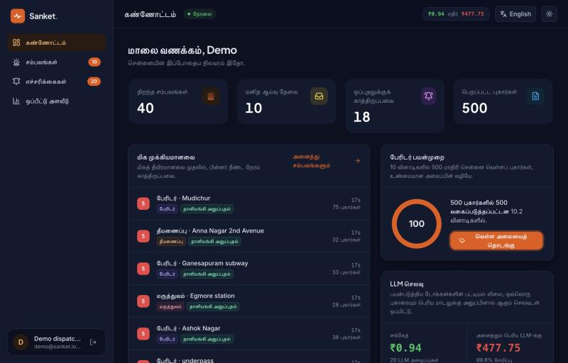
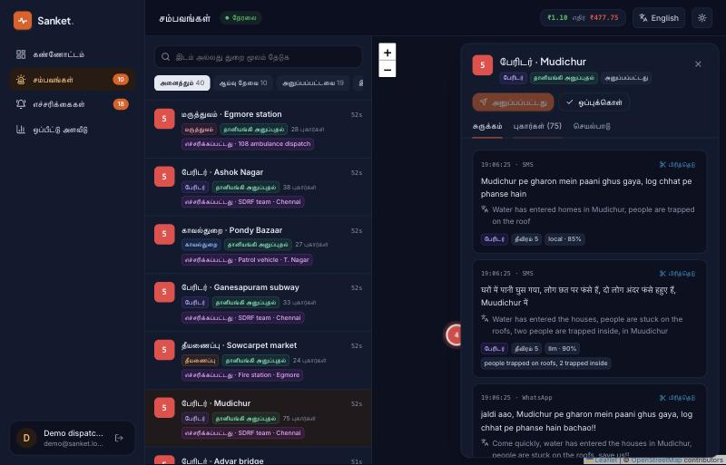
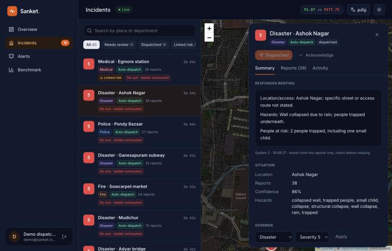
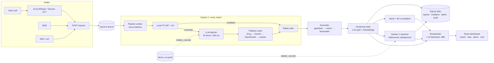

# Sanket · AI emergency triage for Chennai

**When the phone lines flood, Sanket finds the signal.**

Sanket (சங்கேத், "signal") is an AI control room for emergency calls. It takes a surge
of messy, panicked reports in **Tamil, English, Hindi, Hinglish and Bengali**, with typos,
shouting and duplicates included. Seconds later the dispatcher sees a short, ranked list
of real incidents on a live Chennai map, each routed to the right department, each report
with an **English translation**, in a web app that switches between **English and தமிழ்**.
It runs on free-tier models, and nothing is ever auto-dismissed: uncertain calls go to a
human.


| 500 flood reports | become | in | at |
|---|---|---|---|
| 5 languages, duplicates, pranks, 2 silent SOS calls | **12 ranked incidents** on the map | **10.2 s** end to end | **₹0.94** of LLM tokens vs ₹478 for sending each report to a large model (**99.8% less**) |

<p align="center">
  
  
</p>
<p align="center">
  
</p>

### How it thinks

- **System 1, for every report, in about a millisecond.** A local multilingual
  classifier (TF-IDF + logistic regression) answers first. Only uncertain reports go to a
  fast LLM, 25 per request, which also returns an English translation. Safety rules run
  last and can only make things *more* urgent: silent-SOS detection (tap codes, an empty
  line, "can't talk"), a life-safety severity floor, and prank scoring that lowers rank but
  never dismisses.
- **Clustering.** Reports are placed with an offline Chennai gazetteer that understands
  Tamil case endings ("முடிச்சூரில்" = "in Mudichur"), then merged into incidents using a
  1 km grid plus multilingual sentence embeddings. Twenty callers about one fire become one
  incident.
- **Dispatch.** Confident incidents are auto-dispatched, the rest wait for a one-click
  confirm or human review. Alerts escalate up the department's ladder every 90 s until
  someone acknowledges. Every action is audited.
- **System 2, only for complex incidents.** A reasoning model links hazards across reports
  ("smoke on the 5th floor" + "gas smell near the lift" → explosion risk), suggests merges
  for a human to confirm, and writes a 3-line crew briefing. It runs in the background, so
  dispatch never waits for it.
- **Built to survive a demo.** A provider fallback chain (Groq → Gemini → OpenRouter →
  any OpenAI-compatible endpoint) with rate-limit awareness, a live cost ticker, and an
  offline replay mode that runs the whole demo with no API keys and no internet.

**Stack:** Python · FastAPI · asyncio · SQLite (WAL) · scikit-learn · sentence-transformers
· React 19 · Vite · Tailwind v4 · Leaflet · Magic UI · Twilio (voice/SMS, optional).

## Quick start (3 commands)

Needs Python 3.12+ (tested on 3.14) and Node 20+.

```bash
git clone https://github.com/mayank-ydvv/sanket.git && cd sanket
./setup.sh
./run.sh --demo
```

`setup.sh` creates `.env` with a random `CALLER_SALT` (if missing), installs the backend
venv, trains the local classifier, caches the multilingual embedding model, installs the
frontend and resets the database to a clean demo state. It prints the demo account at the
end. Open <http://localhost:5190> and sign in.

`./run.sh --demo` replays a recorded disaster run, so it needs **no API keys and no
internet**. For live mode, add at least one LLM key to `.env` and run `./run.sh`.

## Running the demo

1. **Sign in** with the demo account (`demo@sanket.local`; the password is `DEMO_PASSWORD`
   from `.env`, or the one `setup.sh` printed).
2. **Language**: the **தமிழ் / English** button (top right on every page) switches the
   whole app; the choice is remembered per browser.
3. **Overview → Disaster mode**: 500 reports about 12 Chennai flood events (Mudichur,
   Pallikaranai, Ganesapuram subway, Adyar bridge, …) in five languages arrive in 10 s. Watch the live feed, the KPIs and the cost ticker (actual tokens at list price
   vs sending every report to a large reasoning model). Non-English reports in the feed
   show their English translation underneath.
4. **Incidents**: the ranked list and the map. Open an incident to see its merged reports,
   each with the original text, its English translation and the rules that fired, then the
   audit trail. Use the *Linked risk* filter to find
   incidents where System 2 combined hazards (for example a fire plus a gas smell), and
   read the 3-line crew briefing.
5. **Alerts**: auto-dispatched incidents alert the department's first contact (mock
   sender by default). Anything unacknowledged escalates after 90 s.
6. **Benchmark**: accuracy vs cost for five approaches on the held-out test set.

Reset between rehearsals: stop `run.sh` (Ctrl-C), then
`(cd backend && .venv/bin/python -m scripts.seed_demo)`. The old database is moved to
`backend/backups/`, never deleted.

### Demo replay: when the Wi-Fi or the APIs fail

`DEMO_CACHE=true` (what `./run.sh --demo` sets) serves every fast-LLM decision (with its
translation), every on-demand translation and every System 2 result from `backend/data/demo_run.jsonl` after the delay the provider took
originally, instead of calling any provider. Nominatim and the Hugging Face hub are also switched off (the
gazetteer still places district landmarks; the embedding model is the copy `setup.sh` cached). Everything else runs for real: the local
model, rules, clustering, alerts, escalation, the WebSocket and the cost ticker (fed with
the recorded token counts). The simulator is seeded, so Disaster mode sends the same
reports and they hit the recording. A report that is not in the recording keeps its local
decision and is flagged for review, exactly as when every provider is down.
`GET /health` reports `"mode": "demo-replay"`.

To record a fresh run (needs keys): delete `backend/data/demo_run.jsonl`, start
`DEMO_RECORD=true ./run.sh`, press Disaster mode, and wait until the briefings stop
arriving (on free tiers this takes several minutes).

## Configuration (`.env`)

Every setting is documented in [`.env.example`](.env.example). The important ones:

| Variable | Default | What it does |
|---|---|---|
| `CALLER_SALT` | (required) | salt for hashing caller numbers; `setup.sh` generates one |
| `SESSION_SECRET` | derived from the salt | signs dispatcher session cookies |
| `DEMO_EMAIL` / `DEMO_PASSWORD` | `demo@sanket.local` / random | the account `seed_demo` creates |
| `DEMO_CACHE` / `DEMO_RECORD` | `false` | replay / record the LLM layer (`DEMO_RUN_PATH`) |
| `GROQ_API_KEY`, `GEMINI_API_KEY`, `OPENROUTER_API_KEY` | empty | fast-LLM and reasoning providers; any subset works |
| `CUSTOM_LLM_BASE_URL` / `_API_KEY` / `_MODEL` | empty | any OpenAI-compatible endpoint as an extra fallback |
| `LLM_CHAIN`, `REASONING_CHAIN` | groq→gemini→openrouter→custom | provider order for System 1 and System 2 |
| `CONF_THRESHOLD` | `0.8` | local confidence below this goes to the fast LLM |
| `REASONING_ENABLED` | `true` | turn System 2 on or off |
| `MOCK_ALERTS` | `true` | log alerts instead of sending SMS |
| `TWILIO_*`, `PUBLIC_BASE_URL`, `ALERT_CONTACTS` | empty | voice/SMS intake and real SMS alerts |
| `GEO_*`, `NOMINATIM_*` | Chennai | demo city centre, viewbox and geocoder |
| `AUTH_REQUIRED` | `true` | dispatcher routes need a session |

With no LLM key at all, the app still runs: uncertain reports keep their local decision
and go to the confirm or review lane.

## Architecture



The local decision is placed on the board at once. LLM answers revise reports in place
and re-cluster them when the department or location changes. Rules always run last and
can only raise severity or add review flags.

Tests: `cd backend && .venv/bin/pytest -q` (backend) and `npm --prefix frontend test`.

Post a report by hand:

```bash
curl -X POST localhost:8010/reports -H 'content-type: application/json' \
  -d '{"text":"முடிச்சூரில் வெள்ளம், மக்கள் மாடியில் சிக்கியுள்ளனர்","channel":"sms","caller":"+919999999999"}'
```

# How it works

## Local classifier (System 1)

`scripts/gen_data.py` builds `data/train.jsonl` (600) and `data/test.jsonl` (250) from a
multilingual corpus (English, Hinglish, Hindi, Tamil, Bengali): about 60% emergencies,
25% non-urgent and 15% prank/noise, with 30 hand-written hard cases (sarcasm, silent SOS,
keyword traps, the same event phrased differently). Every third event phrasing per language
is held out for the test set, so test sentences are never seen in training. 50 test rows
are hidden for the final benchmark.

`scripts/train_local.py` fits one shared TF-IDF feature union (char 2–5 + word 1–2) and
three LogisticRegression heads (emergency, department, severity), then prints test
metrics and latency to `backend/artifacts/local_v1.metrics.json`.

## Decision pipeline (System 1)

Every report: **local classifier → fast LLM (only if local confidence < 0.8) → safety rules**.

- **Fast LLM** (`app/decision/llm.py`): uncertain reports from all in-flight batches are
  pooled for up to 300 ms / 25 items and sent as one JSON-mode request, so n uncertain
  reports cost about n/25 calls. Providers are tried in `LLM_CHAIN` order — by default
  Groq (≈1 s) → each Gemini model in `GEMINI_MODELS` (separate free quotas) → OpenRouter →
  any OpenAI-compatible endpoint (e.g. Jev) — each with its own RPM / TPM / output-TPM
  buckets and an explicit output cap. A 429/5xx puts that provider in a jittered
  exponential cooldown and the batch moves on to the next provider at once; hard errors
  (bad key, retired model) park it. The `decision_v2` prompt uses short keys and omits
  default fields (~45 output tokens per report), because output length is what sets both
  latency and free-tier quotas. Output is validated item by item (complete items are
  salvaged even from a truncated reply); missing or invalid items are re-asked once, then
  the local answer stands with `needs_human_review=true`.
- **Rules** (`app/decision/rules.py`) always run last and can only raise severity or add
  review flags: a life-safety severity floor of 3, silent SOS (tap codes, Morse, keyboard
  mash, "can't talk", empty calls → police + human review), hazard tags, and a prank score
  from repeat callers with contradicting reports (rank only, never dismissal).
- **Lanes**: `auto` (emergency, both probabilities ≥ 0.9), `confirm`, `review` (< 0.5,
  silent SOS, or flagged).

Score a running server against 100 held-out test reports:
`cd backend && .venv/bin/python -m scripts.post_reports --n 100`

## Geocoding and incident clustering

- **Location**: the LLM's `location_text`, else the gazetteer extractor: 18 Chennai
  landmarks, each with its English and Tamil name. Tamil names match as word prefixes
  because Tamil adds case endings ("முடிச்சூரில்" = "in Mudichur"); English names tolerate
  typos but never a changed number ("3rd Avenue" is not "2nd Avenue"); Tamil, Devanagari and
  Bengali digits are normalised. Geocoding goes gazetteer → in-memory
  LRU → SQLite `geocode_cache` (misses cached too) → Nominatim, behind one global 1 req/s
  limiter, bounded to the district viewbox, with a custom User-Agent. If the limiter queue
  is too long the report stays "location unconfirmed" instead of stalling triage.
- **Index** (`app/cluster/index.py`): open incidents updated in the last 30 min, bucketed in
  ~1 km grid cells. A located report checks its cell + 8 neighbours, then a ≤ 1 km haversine
  test; an unlocated report checks the 50 most recent incidents of its department. Candidates
  are scored with one matrix-vector product over unit centroids + a department bonus.
  Centroids are running sums (renormalised), expiry is a lazy min-heap. Measured: 5.6 µs per
  lookup at 200 open incidents vs 7.4 µs at 20,000 (constant density).
- **Embeddings**: multilingual MiniLM over `"<department> <hazards>: <text>"`. The canonical
  English tags matter: raw MiniLM scores the same event in Hinglish vs English at ~0.48,
  so untagged text fragmented a 500-report surge into 39–51 incidents; tagged, it gives 13–16.
- **Twin merge**: after a join moves a centroid or location, the incident is re-matched; an
  incident it now matches (typically one started by an unlocated report) is merged into
  the larger one and audited. Dispatchers can split any report back out
  (`POST /incidents/{id}/split`).
- **Severity**: max report severity, +1 (cap 5) past 10 reports or when a report mentions
  children, trapped people or spreading fire.
- **Acceptance**: 500 multilingual reports about 12 events → 13, 13 and 14 incidents on three
  seeds (`tests/test_incidents.py`), ~3 s each including embeddings. The default join
  threshold is 0.70 (+0.15 department bonus): at 0.75 one seed produced 15.

Known limit: a report with no usable location can only be matched by department and text,
so when several same-department events are open at once (~7–9% of surge reports in tests)
it may join the wrong one. These incidents are marked "location unconfirmed" for callback.

## Live board, map and alerts

- **Progressive decisions**: every report is decided by the local model + rules and placed on
  the board immediately (`refining: true` if uncertain). The fast LLM re-checks uncertain
  reports in the background; when it answers, the report is revised in place, and if its
  department changed or it was finally located, it is re-clustered into the right incident.
- **WebSocket** (`/ws`): events `report.created|updated`, `incident.created|updated`,
  `alert.sent|updated`, delivered as one `batch` message at most every 100 ms (≤ 10/s).
  Updates to the same entity within a window coalesce; `*.updated` events carry only the
  fields that changed since the last send.
- **Board**: incidents ranked by severity, then waiting time, with department, confidence,
  lane (auto-dispatch / confirm / human review), silent SOS, prank, needs-review, location and
  alert badges. **Map**: Leaflet pins coloured by severity, clusters coloured by their most
  severe incident, centred on the demo district. **Detail**: merged reports (original text,
  source, confidence, rules fired), alerts, audit trail; Confirm, Acknowledge, Override, Split.
- **Lanes per incident**: any silent SOS → human review; else one report that clears the
  auto-dispatch gate (both probabilities ≥ 0.9) → auto-dispatch; else review if at least half
  the reports are flagged, otherwise one-click confirm.
- **Alerts** (`app/alerts/`): auto-dispatch or one-click confirm alerts the first contact on
  the department's ladder (mock sender, or Twilio SMS over the shared client). One scheduler
  loop over a min-heap of deadlines escalates anything unacknowledged after 90 s to the next
  contact; timers resume after a restart. Every alert, ack, escalation and override is audited.
- **Endpoints**: `POST /incidents/{id}/confirm | /ack | /override | /split`, `GET /alerts`.

## Voice and SMS intake (Twilio)

- `POST /twilio/voice` answers with a Tamil + English prompt (Tamil via Twilio's
  `Google.ta-IN-Standard-A` voice) and records up to 60 s. If the
  caller says nothing, the call is reported with empty text, which the rules treat as a
  silent SOS (police, human review).
- `POST /twilio/recording` replies to Twilio immediately, then in the background downloads
  the MP3, transcribes it (Groq `whisper-large-v3`, ~0.6 s for a 10 s clip; Sarvam `saaras:v3`
  fallback for clips ≤ 30 s), and submits it as a `call` report with the detected language.
  A recording that cannot be transcribed is still submitted, so it reaches a human.
- `POST /twilio/sms` goes straight into the pipeline (the offline / no-data channel).
- Every webhook checks `X-Twilio-Signature` (HMAC-SHA1 over `PUBLIC_BASE_URL` + sorted
  params; verified against Twilio's documented example).

### Setup for a live call

1. **Twilio trial**: sign up at twilio.com (free trial credit). In the console, get a trial
   phone number with Voice + SMS. Copy the Account SID and Auth Token.
2. **Verify the demo phones**: Console → Phone Numbers → Verified Caller IDs. Trial accounts
   only send SMS/calls *to* verified numbers, and callers hear a short trial message first.
3. **Tunnel**: `brew install cloudflared`, then run
   `cloudflared tunnel --url http://localhost:8010` and copy the `https://….trycloudflare.com`
   URL (it changes on every run; an ngrok free static domain avoids that).
4. **Env** (`sanket/.env`): `TWILIO_ACCOUNT_SID`, `TWILIO_AUTH_TOKEN`, `TWILIO_FROM_NUMBER`,
   `PUBLIC_BASE_URL=<tunnel URL>`; restart the API.
5. **Webhooks**: on the number, set "A call comes in" → Webhook,
   `<tunnel>/twilio/voice`, HTTP POST; "A message comes in" → `<tunnel>/twilio/sms`, POST.
6. **Check**: `cd backend && .venv/bin/python -m scripts.twilio_check` posts a signed test
   SMS through the tunnel; then call the number.
7. *(Optional)* real SMS alerts: `MOCK_ALERTS=false` and phone numbers in `ALERT_CONTACTS`
   (verified numbers only on a trial).

Known limits: a Twilio trial number is usually a US number (Indian numbers need regulatory
approval), so calling it from an Indian phone is an international call for the caller.
Spoken numbers are a weak spot: in a test, "सेक्टर बासठ" (sector sixty-two) was transcribed as
"सेक्तर बासक", so a spoken address number may need the LLM's location extraction or a
dispatcher callback. The Tamil greeting voice has not been tried on a live Twilio call yet.

## Disaster mode and cost ticker

`POST /simulate/disaster?n=500&seconds=10&scenario=flood` (or the **Disaster mode** button)
streams a seeded Chennai flood surge through the real pipeline: 12 events across the city
(rooftop rescues in Mudichur, a bus stuck in the Ganesapuram subway, a wall collapse in
Ashok Nagar, the Adyar overflowing, live wires in water, a building
with both a gas smell and a fire upstairs, looting, …) in five languages, with callers
calling back, panic and typos, one prank caller sending contradicting reports, two silent
SOS calls and some non-urgent noise. `GET /simulate/status` and `simulation.updated`
events show progress.

The **cost ticker** (`cost.updated`, at most 2×/s) prices the tokens the providers actually
report, per model, at list price, against a counterfactual of sending every report alone to
a large reasoning model (full prompt + reasoning output). Free tiers bill ₹0; both numbers
are list price, so the comparison holds at production scale.

Measured live on the Chennai scenario (free tiers, 2026-10-18), 500 reports in 10 s:

| | |
|---|---|
| all 500 reports decided and on the board | 10.2 s after the first |
| LLM calls during the surge | 15 (277 reports revised by the LLM, with their English translation; the rest kept their local decision when free-tier limits hit and were translated when their incident was opened) |
| cost at list price | ₹0.94 vs ₹477.75 for all-to-large-LLM during the surge (≈ 99.8% less); ₹1.76 after translating every report and the first System 2 briefings |
| incidents | the 12 events → 12 large incidents (22–75 reports each), plus small ones: non-urgent complaints, the prank caller's decoys, both silent SOS calls (always kept separate), and singletons whose LLM call fell back |
| API memory | ~0.9 GB RSS with both models loaded (Noida run) |

The simulator reuses the corpus phrasings, including those the local model trained on, so
disaster mode shows system behaviour, not accuracy. Accuracy comes from the held-out test
set (`scripts/benchmark.py`, Phase 9).

## System 2: reasoning layer

A slower reasoning model looks only at complex incidents: those with ≥ 3 reports, two or more
distinct hazards, or another open incident within 300 m in the last 15 minutes (severity ≥ 3,
never silent SOS). It runs in the background (`app/reasoning/`), at most once per 20 s per
incident and only when the incident's reports or hazards changed, so dispatch never waits on it.

- **Input**: the incident's newest 30 reports plus nearby incidents (distance, hazards, two
  sample reports each), prompt `reasoning_v1`.
- **Output** (validated and grounded): linked hazards; a `combined_risk` only when hazards
  from different reports add up to more (e.g. "Fire on the 3rd floor combined with a strong
  gas smell: high risk of gas explosion or toxic smoke inhalation"); `merge_suggestions`, kept
  only if they name a nearby incident the model was actually shown; and a 3-line crew
  briefing (location/access, hazards, people at risk, "not stated" when unknown). Stored on
  the incident and audited with the model and prompt version.
- **Dispatcher**: the detail panel shows the linked-risk banner, the briefing and "Merge
  here" buttons (`POST /incidents/{id}/merge`). Merges are suggestions, never automatic.
- **Quotas**: both systems share one rate limiter per provider/model; System 1 runs first.
  A daily-quota 429 parks that provider for 15 min; an incident that cannot be reasoned
  backs off exponentially (20 s → 5 min); due incidents are taken most severe first.
- **Rerouting**: if a dispatched incident's department changes (LLM revision or override),
  the new department is alerted and the old alert stops escalating.

Live observation: right after a 500-report surge the free tiers were exhausted (Gemini's
daily quota, OpenRouter's upstream limit), so System 2 caught up over the following hours
mostly via Groq. With paid or self-hosted capacity it would keep pace; on free tiers,
briefings arrive late in a big surge.

## Benchmark (held-out test set, five approaches)

`python -m scripts.benchmark` (from `backend/`, real API keys) streams the 250 held-out test
reports (incl. 50 hidden during development) at 25/s through each approach and writes
`backend/data/benchmark.json` and [`docs/benchmark.md`](docs/benchmark.md). The app's
**Benchmark** section charts it.

| Approach | Triage acc | Hidden 50 | Recall | ₹ / 1,000 | LLM calls |
|---|---|---|---|---|---|
| keyword rules | 58.4% | 60% | 0.83 | 0 | 0 |
| local only | 52.8% | 54% | 0.93 | 0 | 0 |
| **Sanket hybrid** | **98.0%** | **98%** | **1.00** | **₹2.49** | 12 |
| fast LLM only | 97.2% | 96% | 0.99 | ₹3.13 | 20 |
| reasoning LLM only (gpt-oss-120b) | 92.0% | 98% | 0.97 | ₹22.69 | 46 |

Honest reading: the hybrid is the most accurate and the cheapest LLM approach, but its saving
over "fast LLM only" is small (≈ 20%) because the local model is confident (≥ 0.8) on only 5% of
held-out phrasings, so ~90% of reports still reach the LLM (see the gate table in the report).
Keyword rules beat the local classifier on its own. Latencies are dominated by free-tier
throttling. Pure-LLM approaches re-ask unanswered reports after quotas refill (the hybrid
never needs to, since its local answer stands in).

## Languages and translation

- **Reports** may be in Tamil, English, Hindi, Hinglish or Bengali (or mixed). Tamil callers
  usually name the place in Tamil script, and the gazetteer understands both.
- **English translation of every report** (`reports.english_gloss`; `""` means the report
  was already English):
  - uncertain reports get it for free inside the fast-LLM decision (prompt `decision_v3`
    adds a short `"en"` field), so it arrives with the revised decision;
  - reports the local model decided alone are translated when a dispatcher opens their
    incident (`POST /incidents/{id}/translate`, prompt `translate_v1`): one batched call
    of up to 30 reports on the System 1 provider chain, at most once per report, counted in
    the cost ticker. If no provider is free, the original stays and it is retried on the
    next open.
- **Web app language**: an English / Tamil switch on every page (`frontend/src/lib/messages.ts`
  holds both dictionaries; TypeScript refuses to build if a Tamil string is missing).
  Incident titles are composed in the UI language from department + place. What the LLMs
  write (briefings, linked-risk warnings, hazards) and server error messages other than the
  sign-in ones stay in English.

## Web app

React + Vite + Tailwind with a light/dark theme (remembered; follows the OS by default) and
Magic UI components (Blur Fade, Morphing Text, Animated Beam, Ripple, Magic Card, Bento Grid,
Pulsating Button, Dotted Map, Number Ticker, Animated List, Circular Progress, Flickering Grid,
Marquee, Hyper Text), adapted for Vite in `frontend/src/components/magicui/`.

- `/`: landing page (hero, live-feed demo, how it works, features, measured results).
- `/signup`, `/login`: dispatcher accounts. Passwords are scrypt-hashed in SQLite; sessions
  are HttpOnly HMAC-signed cookies; 5 failed logins per email per 5 min are throttled.
- `/app`: Overview (KPIs, disaster mode, live feed, cost), Incidents (ranked list + map +
  tabbed detail drawer), Alerts (waiting / no-ack / history), Benchmark & cost.

Citizen intake (`POST /reports`, Twilio webhooks) stays public; every dispatcher route and the
WebSocket require a session. `scripts/post_reports.py --email … --password …` logs in first.

## Known limitations

- **Free-tier throughput.** In a 500-report surge the free quotas run out within a minute.
  System 1 degrades gracefully (local decisions stand and are flagged), but System 2
  briefings can arrive minutes to hours late. Paid or self-hosted capacity fixes this.
- **The local gate is narrow.** The local model is confident on only about 5% of held-out
  phrasings, so most reports still reach the fast LLM. The hybrid is the most accurate
  approach and the cheapest LLM one, but only about 20% cheaper than "fast LLM only".
- **Unlocated reports** can be matched only by department and text. When several
  same-department events are open at once, roughly 7–9% of them may join the wrong
  incident. They are marked "location unconfirmed" for a callback, and dispatchers can split.
- **Spoken numbers** are often mis-transcribed ("सेक्टर बासठ" became "सेक्तर बासक"), so voice
  reports may need the LLM's location extraction or a callback.
- **Benchmark numbers are from the earlier Noida dataset.** The corpus was regenerated with
  Chennai places and Tamil-script place names (the local model was retrained: emergency F1
  0.83, department accuracy 0.47 on the visible test split), but the five-way benchmark has
  not been re-run on it yet (it needs a day of fresh free-tier quota). The Benchmark page
  says so.
- **UI Tamil** was written for this demo, not reviewed by a professional translator; LLM
  output (briefings, warnings) is English only.
- **Synthetic data only.** The corpus, simulator and benchmark are generated. The
  simulator reuses training phrasings, so Disaster mode shows behaviour, not accuracy.
- **Demo replay** covers the seeded Disaster mode run. New free-text reports during
  replay get local decisions only. Merge suggestions are not replayed, because incident
  ids differ between runs.
- **Twilio trial**: usually a US number, which only calls or texts verified phones.
- **Single process, SQLite.** One API process holds the clustering index in memory. The
  schema uses portable types, but scaling out needs Postgres and a shared index.
